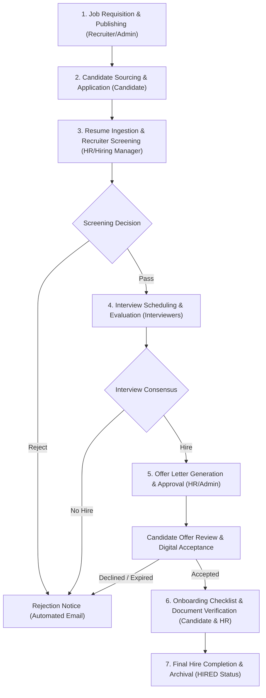
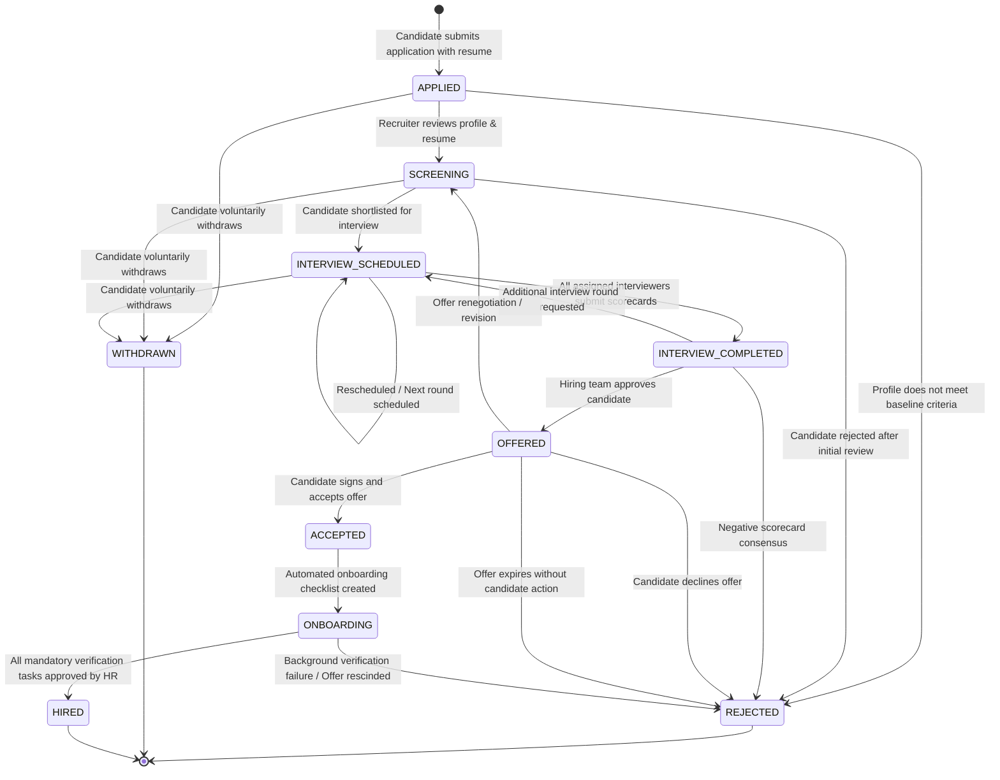
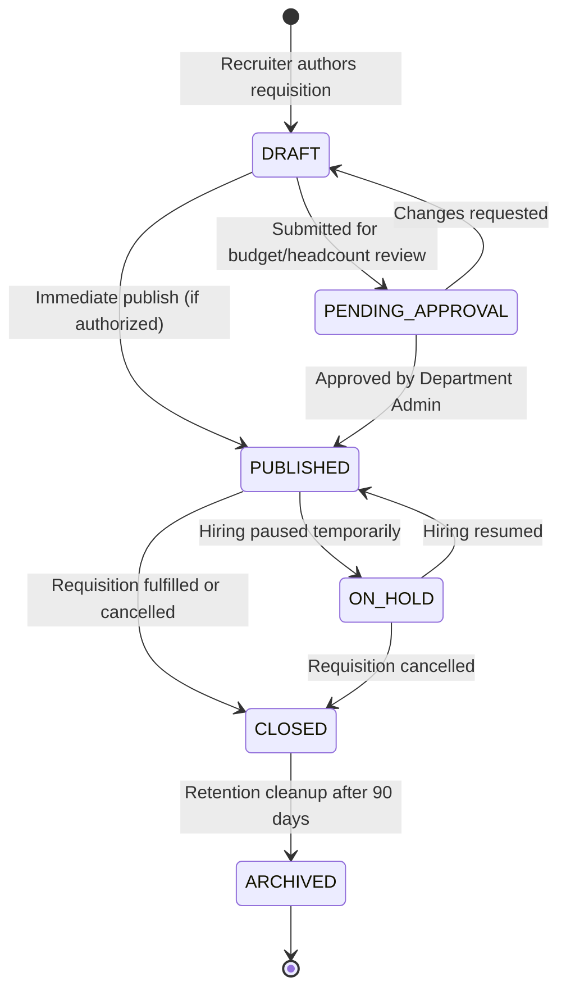
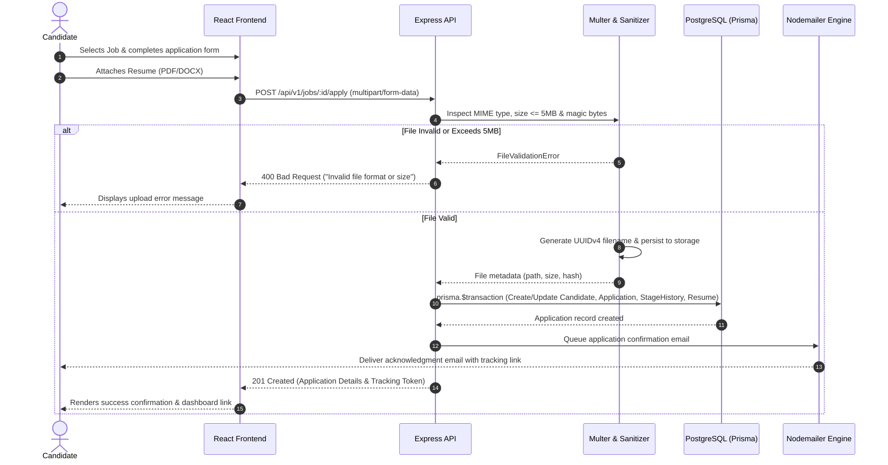
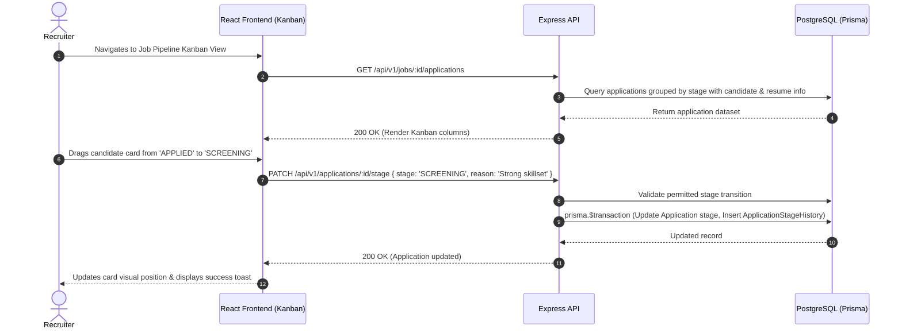
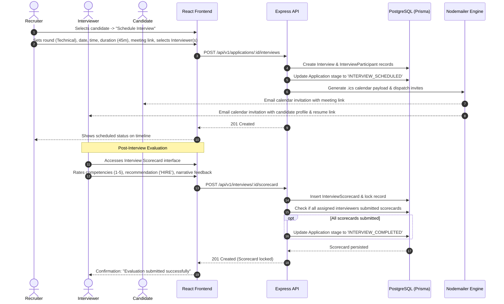
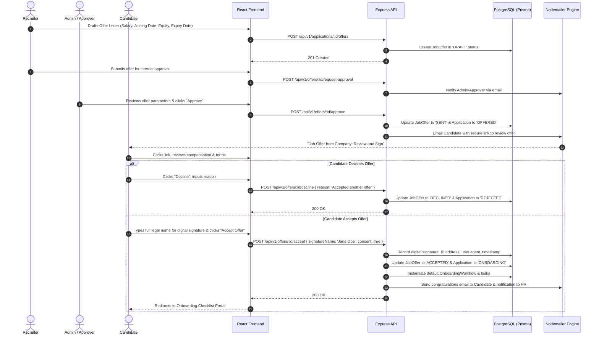
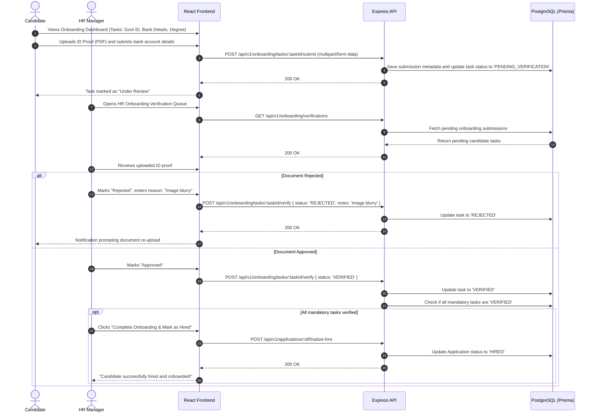

# Complete Application Flow Document (APP_FLOW)

## Smart Recruitment & Applicant Tracking System (ATS)

**Document Version:** 1.0.0  
**Status:** Approved for Implementation (Phase 1 Final)  
**Author:** Senior Full-Stack Software Architect  

---

## 1. High-Level Hiring Lifecycle Flow

The complete hiring process encompasses seven synchronized phases spanning requisition creation to employee onboarding:

---

## 2. State Machines & Transition Logic

### 2.1 Candidate Application State Machine

#### Detailed Transition Matrix: Application Stages

| Current Stage | Permitted Target Stage | Actor / Trigger | Guard Conditions & Automated Actions |
| :--- | :--- | :--- | :--- |
| `APPLIED` | `SCREENING` | Recruiter | Candidate profile and resume verified; stage audit logged. |
| `APPLIED` | `REJECTED` | Recruiter | Rejection reason supplied; rejection email queued. |
| `APPLIED` | `WITHDRAWN` | Candidate | Candidate submits withdrawal; recruiter notified. |
| `SCREENING` | `INTERVIEW_SCHEDULED` | Recruiter | Interview date, duration, and at least 1 interviewer selected. Calendar `.ics` dispatched. |
| `SCREENING` | `REJECTED` | Recruiter / Hiring Mgr | Rejection reason recorded; candidate notified. |
| `INTERVIEW_SCHEDULED` | `INTERVIEW_COMPLETED` | System / Recruiter | All scheduled scorecards submitted and locked. |
| `INTERVIEW_COMPLETED` | `OFFERED` | Recruiter / Admin | Offer letter approved internally by Hiring Manager/Admin. |
| `INTERVIEW_COMPLETED` | `INTERVIEW_SCHEDULED` | Recruiter | New round (e.g., Executive / Cultural) created. |
| `INTERVIEW_COMPLETED` | `REJECTED` | Recruiter | Team decision marked as `NO_HIRE`. |
| `OFFERED` | `ACCEPTED` | Candidate | E-signature executed; timestamp and IP recorded. Onboarding checklist instantiated. |
| `OFFERED` | `REJECTED` | Candidate / System | Candidate clicks decline or expiry date reached. |
| `ACCEPTED` | `ONBOARDING` | System | Automatic trigger upon offer acceptance. |
| `ONBOARDING` | `HIRED` | HR Manager | All required onboarding document tasks marked `VERIFIED`. |

---

### 2.2 Job Requisition State Machine

---

## 3. End-to-End Sequence Diagrams

### 3.1 Flow 1: Candidate Registration & Job Application

---

### 3.2 Flow 2: Recruiter Screening & Pipeline Progression

---

### 3.3 Flow 3: Interview Scheduling & Scorecard Evaluation

---

### 3.4 Flow 4: Offer Generation, Approval & Candidate E-Signature

---

### 3.5 Flow 5: Post-Offer Onboarding Checklist & Verification

---

## 4. Edge Cases & Exception Workflows

### 4.1 Application Withdrawal
* **Trigger:** Candidate opts out by clicking "Withdraw Application" on the portal.
* **Handling:**
  * System prompts for optional reason (e.g., accepted another offer, personal reasons).
  * Backend verifies that the current stage is prior to `HIRED`.
  * Status updates to `WITHDRAWN`.
  * Any scheduled upcoming interviews are automatically flagged as `CANCELLED`, freeing interviewer slots.
  * Recruiter receives a dashboard alert.

### 4.2 Interview Rescheduling
* **Trigger:** Recruiter or Interviewer requests a time change.
* **Handling:**
  * Recruiter updates the interview appointment with new datetime.
  * System retains the original interview ID but increments a `rescheduleCount` attribute.
  * Nodemailer sends an updated `.ics` calendar invitation marked `STATUS:CONFIRMED` with updated sequence number to automatically update participant calendar clients.

### 4.3 Expired Job Offers
* **Trigger:** Scheduled cron/periodic job checks for `SENT` offers whose `expiresAt` date has passed.
* **Handling:**
  * System transitions offer status from `SENT` to `EXPIRED`.
  * Candidate application transitions to `REJECTED` (with sub-status `OFFER_EXPIRED`).
  * Recruiter and Candidate receive notification of offer expiration.
  * Recruiter retains option to extend the expiration date and re-issue the offer.

### 4.4 Disrupted File Uploads
* **Trigger:** Network failure or file verification rejection during resume or onboarding upload.
* **Handling:**
  * Multer unlinks any partially streamed temporary files immediately to prevent orphan disk clutter.
  * Backend returns structured validation error detailing exact failure reason (e.g., `FILE_SIZE_EXCEEDED`, `UNSUPPORTED_MIME_TYPE`).
  * React dropzone resets cleanly and prompts candidate for retry.
