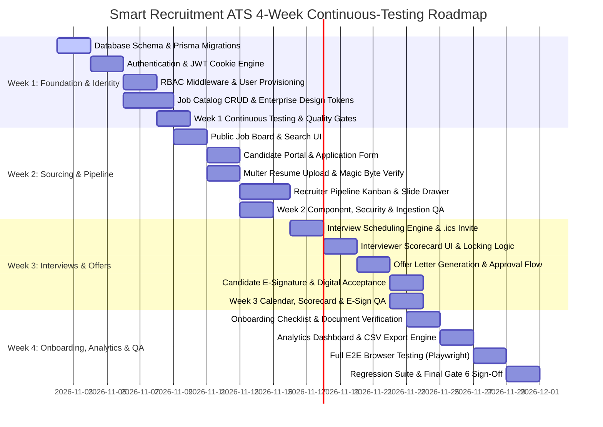

# Four-Week Implementation Roadmap & Acceptance Criteria (IMPLEMENTATION_ROADMAP)

## Smart Recruitment & Applicant Tracking System (ATS)

**Document Version:** 1.0.0  
**Status:** Approved for Implementation (Phase 1 Final)  
**Author:** Senior Full-Stack Software Architect  
**Implementation Methodology:** 4-Week Agile Sprints (Phase 2 Roadmap)  

---

## 1. Executive Implementation Schedule Overview

---

## 2. Weekly Sprint Breakdown & Deliverables

### Week 1: Core Architecture, Authentication & Job Catalog

#### Objectives:
Establish project scaffolding, configure PostgreSQL with Prisma ORM, implement defense-in-depth JWT cookie authentication with `bcrypt`, enforce RBAC middleware across 6 roles, configure Enterprise Design System tokens (`docs/DESIGN_SYSTEM.md`), and deliver Job Requisition APIs and UI.

#### Deliverables & Tasks:
1. **Repository, Tooling & Design System Setup:**
   * Initialize Express backend with ESLint, Prettier, structured folder hierarchy, and environment configuration.
   * Initialize React.js frontend with Tailwind CSS, configure custom Enterprise Design Tokens (Deep Indigo & Slate, `Inter` typography, light/dark themes, `docs/DESIGN_SYSTEM.md`).
2. **Database Engine & ORM:**
   * Configure PostgreSQL database connection.
   * Apply Prisma schema (`schema.prisma`), execute initial migration, and establish seed script for initial roles (`SUPER_ADMIN`, `HR_MANAGER`, etc.).
3. **Authentication & Session Security:**
   * Implement `bcrypt` password hashing (12 rounds) and password complexity validation via Zod.
   * Implement login, register, token refresh, and logout routes with `HttpOnly`, `Secure`, `SameSite=Strict` cookies.
   * Implement account lockout mechanism (5 failed attempts = 15-minute lock).
4. **RBAC Guard Middleware:**
   * Build `requireRoles` and `requireOwnershipOrAdmin` Express middleware reconciling Admin, HR, and Candidate tracks across all 6 roles.
5. **Job Catalog Module:**
   * Implement Job Requisition models, controllers, and services with status transitions (`DRAFT` -> `PUBLISHED` -> `CLOSED`).
   * Build Admin/Recruiter Job Management dashboard in React conforming to `docs/UI_UX_SPECIFICATION.md`.
6. **Continuous Quality Gate Verification (Week 1):**
   * Execute Unit Tests (Jest) for Auth and Job Catalog business logic.
   * Execute API Integration Tests (Supertest) verifying cookies, token rotation, and 6-role RBAC boundaries.
   * Verify Gate 0, Gate 1, and Gate 2 pass criteria; zero P0/P1 defects (`docs/QUALITY_GATES.md`).

#### Week 1 Milestone:
> Secure user authentication operational across all roles; enterprise design system configured; admins and recruiters can author, configure, and publish job requisitions; 100% of Week 1 tests passing.

---

### Week 2: Candidate Applications, Resume Ingestion & Pipeline Kanban

#### Objectives:
Deliver the public-facing careers portal, candidate application flow with Multer-based resume file upload and sanitization, candidate dashboard, and interactive recruiter Kanban pipeline board with slide-out candidate drawer.

#### Deliverables & Tasks:
1. **Public Career Portal:**
   * Build responsive public job listing page with search, department filtering, and pagination.
   * Build detailed job description view with "Apply Now" call-to-action.
2. **Resume Upload Pipeline (Multer):**
   * Implement Multer storage middleware with strict 5MB limit and PDF/DOCX whitelist.
   * Integrate magic-byte signature inspection to block disguised binaries.
   * Store resumes outside webroot with UUIDv4 filenames and secure streaming endpoint (`/api/v1/resumes/:id/download`).
3. **Candidate Application Workflow:**
   * Create candidate application form with React Hook Form + Zod.
   * Support atomic candidate account creation and application persistence in a single Prisma transaction.
   * Dispatch application confirmation email via Nodemailer.
4. **Recruiter Pipeline & Kanban Board:**
   * Build drag-and-drop / stage-transition Kanban view categorized by application stages (`APPLIED`, `SCREENING`, `INTERVIEW_SCHEDULED`, etc.).
   * Enforce stage machine rules and record every transition in `ApplicationStageHistory`.
   * Implement candidate profile preview drawer with inline resume viewer.
5. **Continuous Quality Gate Verification (Week 2):**
   * Component & Interaction Tests (RTL) for public job search, file dropzone, and Kanban drag-and-drop.
   * Security Ingestion Tests: verify rejection of non-PDF/DOCX, corrupted headers, and oversized files.
   * Verify Gate 3 and Gate 4 pass criteria; zero P0/P1 defects.

#### Week 2 Milestone:
> Candidates can discover jobs and apply with validated resumes; recruiters can triage candidates across visual Kanban stages with audit history tracking; all Week 2 quality gates satisfied.

---

### Week 3: Interview Coordination, Scorecards & Offer Management

#### Objectives:
Implement panel interview scheduling with calendar integration, interviewer structured evaluation forms, offer letter drafting, internal approvals, and candidate digital signature acceptance.

#### Deliverables & Tasks:
1. **Interview Scheduling Engine:**
   * Build interview booking modal allowing selection of round type, datetime, duration, meeting link, and interviewer panel.
   * Implement Nodemailer iCalendar (`.ics`) generator dispatching synchronized calendar invites to candidates and interviewers.
2. **Interviewer Evaluation & Scorecards:**
   * Build dedicated Interviewer portal displaying assigned candidate profiles and resumes.
   * Build structured scorecard UI with 1-5 rating across competencies, overall recommendation (`STRONG_HIRE`, `HIRE`, `NO_HIRE`), and narrative notes.
   * Enforce immutable locking (`isLocked: true`) upon submission.
3. **Offer Letter Generation:**
   * Build offer letter creation interface with compensation breakdown, joining date, and customizable terms.
   * Implement internal offer approval workflow by Department Manager or Admin.
4. **Candidate Offer Review & Digital Acceptance:**
   * Implement candidate offer viewing screen with compensation details.
   * Implement legally compliant digital acceptance recording candidate full name, IP address, user agent, and timestamp.
   * Handle offer decline and expiration logic.
5. **Continuous Quality Gate Verification (Week 3):**
   * Test Nodemailer mock to verify valid `.ics` calendar attachment generation.
   * Test scorecard submission lock invariants (ensure subsequent edits return 403 Forbidden).
   * Test digital offer acceptance recording and stage progression; verify Gate 3 & Gate 4 pass criteria.

#### Week 3 Milestone:
> Recruiter schedules interviews with automated calendar invites; interviewers submit locked scorecards; offers are generated, approved, and digitally signed by candidates; all Week 3 quality gates satisfied.

---

### Week 4: Onboarding, Analytics, End-to-End Testing & Handover

#### Objectives:
Build the post-offer onboarding document checklist and verification workflow, deliver executive recruitment analytics, execute comprehensive automated testing suites, perform security hardening, and complete final production handover.

#### Deliverables & Tasks:
1. **Onboarding Management Module:**
   * Automatic instantiation of onboarding checklist upon offer acceptance (`ONBOARDING` stage).
   * Build candidate onboarding portal for uploading ID proofs, educational certificates, and emergency contacts.
   * Build HR verification queue to review, verify, or reject submitted documents.
   * Enable final "Complete Hire" action transitioning candidate to `HIRED`.
2. **Hiring Analytics & Reporting:**
   * Build executive analytics dashboard: Time-to-Hire, Funnel Drop-off Velocity, Sourcing Breakdown, and Offer Acceptance Rate.
   * Implement sanitized CSV export endpoint for recruitment audit compliance.
3. **Continuous Testing & Full Suite Execution:**
   * Backend Unit & Integration Tests: Complete suite passing (>80% coverage).
   * Frontend Component Tests: React Testing Library suite passing across Light/Dark modes.
   * Cross-Browser E2E Automation: Playwright covering the full hiring lifecycle (Application -> Interview -> Offer -> Onboard).
   * Full regression testing ensuring all features operate harmoniously.
4. **Production Hardening & Sign-Off:**
   * Security audit: Helmet headers, CORS policies, rate limiting, and dependency vulnerability scan (`npm audit`).
   * Performance optimization: Database index verification, response compression, query profiling.
   * Gate 6 Release Sign-Off verified against all 12 acceptance criteria (`AC-01` to `AC-12`).

#### Week 4 Milestone:
> Fully tested, production-ready Smart Recruitment ATS platform meeting all functional, design, testing, and security acceptance criteria with Gate 6 architectural sign-off.

---

## 3. Measurable Project Acceptance Criteria

| Criteria ID | Category | Requirement Specification | Verification Method | Pass Threshold |
| :--- | :--- | :--- | :--- | :--- |
| **AC-01** | Authentication | Password hashing uses `bcrypt` (12 rounds); session tokens reside in `HttpOnly, Secure, SameSite=Strict` cookies. | Supertest API test inspecting `Set-Cookie` headers & DB inspection. | 100% compliant; zero token leakage in response bodies. |
| **AC-02** | Security | Account locks out after 5 consecutive failed login attempts for 15 minutes. | Automated integration test script simulating failed logins. | Account locked exactly after 5th attempt with 429/401 response. |
| **AC-03** | RBAC | Role permissions strictly enforced on every route. Candidates or unauthorized roles cannot access admin/recruiter endpoints. | Automated RBAC test suite testing every endpoint against all 5 roles. | 100% of unauthorized requests return `401 Unauthorized` or `403 Forbidden`. |
| **AC-04** | File Ingestion | Multer upload blocks non-PDF/DOCX files, files > 5MB, and files failing magic byte inspection. | Supertest multipart upload tests with `.exe`, corrupted headers, and oversized files. | All invalid files rejected with `400 Bad Request`. |
| **AC-05** | Pipeline Integrity | Application stage movement satisfies the state machine; transitions persist in `ApplicationStageHistory`. | Integration test verifying database state before and after transition. | State updated and historical audit log record created atomically. |
| **AC-06** | Scheduling & Email | Interview creation dispatches email with valid `.ics` calendar payload to candidate and panel. | Unit/Integration test asserting Nodemailer transporter send arguments. | Transporter called with valid `.ics` payload matching interview parameters. |
| **AC-07** | Scorecard Locking | Once submitted, scorecards become immutable and cannot be modified by the author. | Integration test attempting `PUT/PATCH` on submitted scorecard. | Returns `403 Forbidden` / `422 Unprocessable Entity`. |
| **AC-08** | Digital Offer | Offer acceptance records legal full name, IP address, user agent, and timestamp, triggering onboarding. | E2E Playwright test executing candidate offer sign. | Offer updated to `ACCEPTED`, Application to `ONBOARDING`, tasks instantiated. |
| **AC-09** | Onboarding Flow | Candidate cannot be marked `HIRED` until all mandatory onboarding tasks are verified. | API test attempting hire finalization with pending tasks. | Returns `400/422` error stating mandatory tasks remain unverified. |
| **AC-10** | Analytics | Time-to-Hire and Funnel Drop-off metrics calculate accurately across active candidates. | Integration test comparing calculated averages with test fixture timestamps. | Mathematical accuracy within 0.1% tolerance. |
| **AC-11** | Test Coverage | Automated test suites cover critical business logic and user journeys. | Jest coverage report & Playwright E2E test report. | Backend service test coverage >= 80%; all Playwright E2E suites passing. |
| **AC-12** | Performance | p95 API response times < 200ms; First Contentful Paint < 1.5s on public portal. | Automated load test benchmark & Lighthouse performance audit. | p95 < 200ms; Lighthouse Performance Score >= 90. |

---

## 4. Risk Assessment & Mitigation Matrix

| Identified Risk | Severity | Probability | Architectural Mitigation Strategy |
| :--- | :---: | :---: | :--- |
| **Malicious File Uploads** | High | Low | Multi-layered defense: Multer size limits, MIME whitelisting, magic byte validation, UUID filename randomization, and storage outside web root without execute permissions. |
| **Interviewer Scorecard Delays** | Medium | High | Automated email reminders dispatched via Nodemailer 2 hours and 24 hours post-interview; Recruiter dashboard highlights pending scorecards. |
| **SMTP Delivery Latency / Outage** | Medium | Low | Email dispatching is decoupled from primary request threads; errors are logged in `EmailLog` without rolling back primary transactions. |
| **Race Conditions in Pipeline Moves** | Medium | Medium | Optimistic locking using `updatedAt` timestamps and Prisma transaction isolation levels. |
| **Unauthorized Data Access (PII)** | High | Low | Principle of least privilege enforced via RBAC middleware; candidate PII masked from panel interviewers. |
