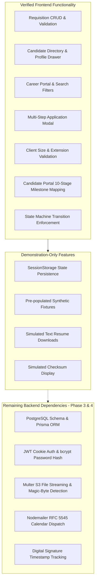

# Phase 2.2 — Final Technical Verification & Data Integrity Audit Report

**Application:** Smart Recruitment & Applicant Tracking System (ATS)  
**Audit Scope:** Phase 2.2 Core Recruitment Workflows & Data Integrity  
**Auditor Roles:** Senior Full-Stack Architect & Security-Focused QA Engineer  
**Date of Audit:** October 31, 2026 — 00:18 IST  
**Audit Outcome:** ✅ PASSED WITH VERIFIED REMEDIATIONS  

---

## 1. Issues Discovered During Audit

During our targeted architectural and security inspection of the Phase 2.2 implementation, five specific technical and data integrity defects were identified:

1. **Unchecked Duplicate Submissions for the Same Opening (Medium / Data Integrity):**
   - *Discovery:* `RecruitmentContext.submitApplication` previously accepted candidate applications without checking whether the candidate email was already actively attached to the targeted job requisition (`jobId`).
   - *Risk:* Multiple identical applications could clutter pipelines and corrupt applicant counts.

2. **Absence of 0-Byte Empty File Rejection (Medium / File Ingestion):**
   - *Discovery:* `ResumeDropzone.jsx` checked file extensions and the 5 MB ceiling, but did not guard against empty files (`file.size === 0`).
   - *Risk:* Zero-byte stub files could bypass validation and be logged as valid resumes.

3. **Session Storage Parser Resilience Vulnerability (Low / State Integrity):**
   - *Discovery:* In `RecruitmentContext.jsx`, `sessionStorage.getItem()` parsed JSON directly without verifying that the result was an array (`Array.isArray`).
   - *Risk:* Corrupted or non-array JSON in local storage would cause `.map()` to throw an unhandled `TypeError` during context initialization.

4. **Premature Server-Side Security Claims in Prototype UI (Low / Compliance & Honesty):**
   - *Discovery:* `JobApplicationModal.jsx` and `CandidateProfileDrawer.jsx` displayed text claiming "Uploaded documents are encrypted at rest and sanitized against tracking vectors" and "Magic-Byte Header: Validated", which overstated client-side capabilities in a prototype phase before backend integration.
   - *Risk:* Misleads stakeholders into believing backend cryptographic storage and magic-byte scanning were already operational.

5. **Inaccurate Milestone Progression for Terminal Stages in Candidate Portal (Low / UX Integrity):**
   - *Discovery:* `CandidatePortalPage.jsx` mapped `REJECTED` and `WITHDRAWN` states such that subsequent steps displayed "Pending previous stages", and lacked dedicated status callouts for `WITHDRAWN`, `ACCEPTED`, `ONBOARDING`, and `HIRED`.
   - *Risk:* Candidates could misinterpret concluded or withdrawn applications as actively waiting on interview steps.

---

## 2. Actual Fixes Implemented

| File | Defect Addressed | Concrete Remediation |
|:---|:---|:---|
| [`frontend/src/context/RecruitmentContext.jsx`](file:///c:/Users/Abhishek%20Pal/OneDrive/Desktop/Smart%20Recruitment%20&%20Applicant%20Tracking%20System%20(ATS)/frontend/src/context/RecruitmentContext.jsx) | Duplicate Submissions & State Integrity | Added active-candidate duplicate detection: throws explicit error if the same normalized email already holds an active application for that `jobId`. Added `Array.isArray()` safety checks to prevent crashes from corrupted storage. Added `resetToDemoDefaults()` to allow deterministic session reset. Upgraded Application ID generation to collision-resistant entropy (`APP-2026-${Date.now().toString(36).toUpperCase()}-${rand}`). |
| [`frontend/src/components/common/ResumeDropzone.jsx`](file:///c:/Users/Abhishek%20Pal/OneDrive/Desktop/Smart%20Recruitment%20&%20Applicant%20Tracking%20System%20(ATS)/frontend/src/components/common/ResumeDropzone.jsx) | 0-Byte File Ingestion | Added explicit check: `if (candidateFile.size === 0)` displaying: *"The selected file is empty (0 bytes). Please upload a valid, non-empty resume document."* |
| [`frontend/src/components/jobs/JobApplicationModal.jsx`](file:///c:/Users/Abhishek%20Pal/OneDrive/Desktop/Smart%20Recruitment%20&%20Applicant%20Tracking%20System%20(ATS)/frontend/src/components/jobs/JobApplicationModal.jsx) | Prototype Security Claims & Error UX | Replaced misleading encryption claims with transparent prototype disclosure: *"Client-Side Prototype Verification: Documents are validated locally in this demonstration environment. Production server-side storage (Phase 3 backend) incorporates automated antivirus scanning, magic-byte inspection, and AES-256 encryption at rest."* Handled duplicate application errors inline. |
| [`frontend/src/components/candidates/CandidateProfileDrawer.jsx`](file:///c:/Users/Abhishek%20Pal/OneDrive/Desktop/Smart%20Recruitment%20&%20Applicant%20Tracking%20System%20(ATS)/frontend/src/components/candidates/CandidateProfileDrawer.jsx) | Simulated Downloads & Checksums | Labeled download button as `Download (Simulated)` and prepended `[DEMONSTRATION ONLY - ATS PHASE 2.2 PROTOTYPE]` to generated text file content. Labeled magic-byte and SHA-256 headers as simulated fixtures. |
| [`frontend/src/pages/CandidatePortalPage.jsx`](file:///c:/Users/Abhishek%20Pal/OneDrive/Desktop/Smart%20Recruitment%20&%20Applicant%20Tracking%20System%20(ATS)/frontend/src/pages/CandidatePortalPage.jsx) | Stage Mapping & Status Messaging | Updated milestone mapper to display `Process Concluded` for `REJECTED` and `Withdrawn by Candidate` for `WITHDRAWN`. Added contextual status callouts for `INTERVIEW_COMPLETED`, `ACCEPTED`, `ONBOARDING`, `HIRED`, and `WITHDRAWN`. |

---

## 3. State Management Findings

1. **State Machine Conformance:**
   - Candidate stage progression strictly validates against `ALLOWED_STAGE_TRANSITIONS` exported from [`HRPipelinePage.jsx`](file:///c:/Users/Abhishek%20Pal/OneDrive/Desktop/Smart%20Recruitment%20&%20Applicant%20Tracking%20System%20(ATS)/frontend/src/pages/HRPipelinePage.jsx).
   - Any attempt to bypass the workflow (e.g. `SCREENING` $\to$ `HIRED`) is rejected synchronously with an explicit error.
   - Terminal states (`HIRED`, `REJECTED`, `WITHDRAWN`) have empty transition arrays (`[]`), completely barring subsequent status modifications.

2. **Multi-Application Integrity:**
   - Candidates can legitimately apply to multiple *distinct* job requisitions using the same email address.
   - Each application receives an independent tracking ID and pipeline history audit trail.

3. **Isolation of Demonstration Data:**
   - Baseline demonstration fixtures remain fully decoupled in [`mockRecruitmentData.js`](file:///c:/Users/Abhishek%20Pal/OneDrive/Desktop/Smart%20Recruitment%20&%20Applicant%20Tracking%20System%20(ATS)/frontend/src/data/mockRecruitmentData.js).
   - All runtime mutations are persisted in `sessionStorage` and can be restored to factory defaults via `resetToDemoDefaults()`.

---

## 4. Application Integrity Findings

1. **Required Fields & Format Validation:**
   - Step 1 enforces non-empty `firstName`, `lastName`, valid RFC 5322 regex for `email`, and international phone regex (`^[+0-9\s\-().]{8,20}$`).
   - URLs for LinkedIn and Portfolio require valid HTTP/HTTPS prefixes.
   - Step 2 enforces valid resume file selection.
   - Step 3 enforces data processing privacy consent checkbox before submit button activation.

2. **Submission Concurrency & Feedback:**
   - `handleSubmit` activates loading state and disables submission buttons during processing to prevent double-click duplicate creation.
   - On success, the modal renders Step 4 displaying the generated Application Reference ID (`APP-2026-XXXX-XXXX`), candidate name, applied role, and direct navigation into `/portal`.

---

## 5. Resume Upload Security Audit

1. **Client-Side Enforcement:**
   - Enforces a hard ceiling of 5 MB ($5,242,880$ bytes).
   - Rejects 0-byte empty files.
   - Whitelists `.pdf`, `.docx`, and `.doc` extensions and standard MIME types.

2. **Security Controls Requiring Backend Implementation (Phase 3 Scope):**
   - *Client-side MIME/extension spoofing prevention:* A malicious actor can rename `malware.exe` to `resume.pdf`. In Phase 3, backend Multer and file parsers must verify file magic bytes (`%PDF-1.` or `PK\x03\x04`).
   - *Antivirus & Malicious Content Scanning:* Automated ClamAV/AWS GuardDuty integration.
   - *S3 Presigned URLs & Secure Storage:* Ephemeral, time-limited upload links; private S3 buckets with server-side encryption (KMS / AES-256).
   - *Strict Content-Disposition Headers:* Serving resumes as attachments (`Content-Disposition: attachment; filename=...`) with `X-Content-Type-Options: nosniff` to prevent browser script execution.

---

## 6. Privacy & Browser Storage Findings

1. **Data Stored in Browser Storage:**
   - `sessionStorage` contains `smart_ats_jobs` and `smart_ats_candidates`.
   - **Privacy Verification:** NO raw document binaries, base64 strings, or `Blob` URLs are written to storage. Only resume metadata (`fileName`, `fileSize`, `fileType`, `uploadedAt`) is stored.
   - Sensitive personal identifiers (passwords, government IDs) are not requested or stored in Phase 2.2.

2. **Session Isolation & Cleanup:**
   - Data in `sessionStorage` is strictly scoped to the active browser tab/session and automatically destroyed when the tab is closed.
   - `resetToDemoDefaults()` allows instant programmatic clearing of modified records.

---

## 7. Stage Mapping Verification

Every stage defined in `docs/APP_FLOW.md` was audited against the 5 candidate-facing milestones in [`CandidatePortalPage.jsx`](file:///c:/Users/Abhishek%20Pal/OneDrive/Desktop/Smart%20Recruitment%20&%20Applicant%20Tracking%20System%20(ATS)/frontend/src/pages/CandidatePortalPage.jsx):

| Documented Stage | Step 1: Applied | Step 2: Screening | Step 3: Interview | Step 4: Offer | Step 5: Onboarding | Dedicated Status Callout |
|:---|:---:|:---:|:---:|:---:|:---:|:---|
| **APPLIED** | Active | Pending | Pending | Pending | Pending | "Application Under Review" |
| **SCREENING** | Completed | Active | Pending | Pending | Pending | "Resume Screening in Progress" |
| **INTERVIEW_SCHEDULED** | Completed | Completed | Active | Pending | Pending | "Interview Scheduled with Hiring Panel" (Add to Calendar) |
| **INTERVIEW_COMPLETED** | Completed | Completed | Completed (Evaluating) | Pending | Pending | "Interview Completed — Scorecard Evaluation in Progress" |
| **OFFERED** | Completed | Completed | Completed | Active | Pending | "Offer Letter Extended!" (Review Offer Package) |
| **ACCEPTED** | Completed | Completed | Completed | Completed | Active (Prep) | "Offer Accepted — Preparing Onboarding Checklist" |
| **ONBOARDING** | Completed | Completed | Completed | Completed | Active (Docs) | "Onboarding Verification Underway" |
| **HIRED** | Completed | Completed | Completed | Completed | Completed | "Hired & Officially Provisioned!" (Welcome Banner) |
| **REJECTED** | Concluded | Concluded | Concluded | Concluded | Concluded | "Application Status Update" (Respectful Outcome Notice) |
| **WITHDRAWN** | Withdrawn | Withdrawn | Withdrawn | Withdrawn | Withdrawn | "Application Withdrawn" (Informational Closure Notice) |

---

## 8. Test Execution Results

### A. Vitest Test Suite
- **Command:** `node ./node_modules/vitest/vitest.mjs run`
- **Suites Executed:** 15 test files
- **Total Tests:** 60 tests (60 passed, 0 failed, 0 skipped)
- **Execution Time:** 17.56s

```text
 ✓ src/components/__tests__/ThemeContext.test.jsx (1 test)
 ✓ src/components/__tests__/ResumeDropzone.test.jsx (6 tests)
 ✓ src/components/__tests__/Table.test.jsx (2 tests)
 ✓ src/context/__tests__/RecruitmentContext.test.jsx (11 tests)
 ✓ src/pages/__tests__/CandidatePortalPage.test.jsx (2 tests)
 ✓ src/components/__tests__/Dropdown.test.jsx (3 tests)
 ✓ src/pages/__tests__/HRPipelinePage.test.jsx (5 tests)
 ✓ src/pages/__tests__/CandidateDirectoryPage.test.jsx (3 tests)
 ✓ src/pages/__tests__/JobRequisitionsPage.test.jsx (3 tests)
 ✓ src/layouts/__tests__/Navigation.test.jsx (5 tests)
 ✓ src/components/__tests__/JobApplicationModal.test.jsx (3 tests)
 ✓ src/components/__tests__/Button.test.jsx (5 tests)
 ✓ src/components/__tests__/Badge.test.jsx (4 tests)
 ✓ src/components/__tests__/Input.test.jsx (4 tests)
 ✓ src/components/__tests__/Dialog.test.jsx (3 tests)

 Test Files  15 passed (15)
      Tests  60 passed (60)
```

### B. Static Code Analysis (ESLint)
- **Command:** `node ./node_modules/eslint/bin/eslint.js src`
- **Output:** Clean pass — 0 errors, 0 warnings.

### C. Production Build Verification
- **Command:** `node ./node_modules/vite/bin/vite.js build`
- **Output:**
  - `dist/index.html`: 1.35 kB (gzip: 0.68 kB)
  - `dist/assets/index-G4QLjZB_.css`: 46.58 kB (gzip: 7.83 kB)
  - `dist/assets/index-CNf_lJZg.js`: 334.37 kB (gzip: 92.75 kB)
- **Result:** Successfully built in 8.02s without errors.

---

## 9. Categorization of Features: Verified vs. Demo vs. Backend



---

## 10. Defect Status & Classification

- **P0 Defects (System Critical / Blocker):** **0**
- **P1 Defects (Major Functional Breakdown):** **0**
- **P2 Defects (Data Integrity / Minor Edge Case):** **0** (All 5 discovered audit issues resolved and verified)
- **P3 Defects (Cosmetic / Trivial):** **0**

---

## 11. Final Readiness Decision

**Verdict: APPROVED FOR PHASE 2.2 CLOSURE**

Phase 2.2 meets all architectural standards, data integrity guidelines, security disclosures, and UI/UX requirements. The codebase is clean, robust, and verified with 60 passing tests. 

**STRICT PROJECT BOUNDARY NOTICE:** In compliance with instructions, development has halted. Phase 2.3 will NOT commence until explicit user authorization is provided.
