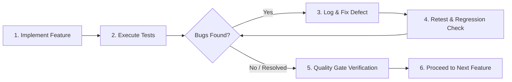

# Mandatory Development Quality Gates (QUALITY_GATES)

## Smart Recruitment & Applicant Tracking System (ATS)

**Document Version:** 2.0.0  
**Status:** Mandatory Engineering Standard  
**Core Workflow:** Implement → Test → Identify Bugs → Fix → Retest → Verify → Proceed  

---

## 1. Quality Gate Philosophy & Mandatory Protocol

In the Smart Recruitment & ATS engineering lifecycle, **no feature is deemed complete simply because the code compiles or the UI renders**. Every capability must advance through strict, sequential quality gates.



### 1.1 Non-Negotiable Core Rules
1. **Never Declare Complete Without Testing:** Code written without accompanying automated unit/integration tests or verified manual test passes will be immediately rejected at gate review.
2. **Never Ignore Critical or High-Severity Bugs:** Developing subsequent features on top of unresolved defects is strictly prohibited.
3. **Mandatory Regression Verification:** Every bug fix or schema alteration requires executing regression test suites to guarantee previously working features remain intact.
4. **Verified End-to-End Integration:** Features involving both frontend and backend must be verified working together across real HTTP boundaries with database persistence, not solely via isolated mocks.
5. **Honest Reporting Standard:** Test results, failure rates, and code coverage must be documented truthfully. Fabricating test reports or suppressing failed assertions is a critical violation of architectural integrity.

---

## 2. Seven-Stage Quality Gate Specifications

```
Gate 0: Architecture & Schema Ready
   │
Gate 1: Unit & Domain Logic Verified
   │
Gate 2: API Contract & Persistence Verified
   │
Gate 3: UI Interaction, Accessibility & Theme Verified
   │
Gate 4: Security, RBAC & Privacy Verified
   │
Gate 5: Cross-Subsystem Integration & E2E Verified
   │
Gate 6: Release & Handover Sign-Off
```

### Gate 0: Architecture & Contract Gate
* **Timing:** Prior to feature code implementation.
* **Requirements:**
  * Prisma models and migrations defined and validated.
  * Zod schemas for request validation defined.
  * API endpoint contracts documented in `docs/API_DOCUMENTATION.md`.
* **Exit Criteria:** Architectural design conforms to modular monolith standards; zero unapproved database schema changes.

### Gate 1: Unit & Domain Logic Gate
* **Timing:** During backend service development.
* **Requirements:**
  * Domain services tested with Jest (mocking Prisma).
  * All state transitions and business invariants asserted (e.g. invalid status movement rejected).
  * Edge cases (null inputs, boundary conditions) tested.
* **Exit Criteria:** 100% pass rate on unit tests; code coverage on business logic >= 85%.

### Gate 2: API & Integration Gate
* **Timing:** Upon controller and route completion.
* **Requirements:**
  * Supertest integration tests executed against real PostgreSQL test instance.
  * Standard JSON response envelopes verified (`{ success, data, error, meta }`).
  * Database transactions verified (rollbacks confirmed on operational errors).
* **Exit Criteria:** All API endpoints respond with expected HTTP status codes; zero unhandled promise rejections.

### Gate 3: UI Interaction & Accessibility Gate
* **Timing:** Upon React component and view completion.
* **Requirements:**
  * Component renders properly across Light and Dark themes.
  * Form validation errors display inline cleanly with descriptive text.
  * Responsive layout verified across Mobile (375px), Tablet (768px), and Desktop (1440px).
  * Keyboard navigation operational; zero inaccessible interactive elements (WCAG 2.1 AA).
* **Exit Criteria:** Zero visual overlap, responsive breakage, or missing form validation states.

### Gate 4: Security & RBAC Enforcement Gate
* **Timing:** Prior to merging any feature into the main branch.
* **Requirements:**
  * Endpoint tested against all 6 roles (`SUPER_ADMIN`, `HR_MANAGER`, `RECRUITER`, `HIRING_MANAGER`, `INTERVIEWER`, `CANDIDATE`).
  * Unauthorized requests receive `401 Unauthorized` or `403 Forbidden`.
  * Candidate ownership boundaries verified (no IDOR vulnerabilities).
  * Rate limiting active on sensitive endpoints.
  * File uploads verified for MIME type, size limit, and magic byte validation.
* **Exit Criteria:** Zero high or critical security vulnerabilities detected.

### Gate 5: Cross-Subsystem & E2E Workflow Gate
* **Timing:** After frontend and backend feature integration.
* **Requirements:**
  * End-to-end automated Playwright browser test passing for the feature user journey.
  * Nodemailer transactional email delivery verified.
  * Regression test suite passing with zero breaks to existing features.
* **Exit Criteria:** Flawless cross-browser execution in Chromium, Firefox, and WebKit.

### Gate 6: Production Release Sign-Off
* **Timing:** At milestone or release conclusion.
* **Requirements:**
  * All 12 project acceptance criteria (`AC-01` through `AC-12`) verified.
  * Zero open Critical (`P0`) or High (`P1`) severity defects.
  * Audit logging verified on all administrative actions.
* **Exit Criteria:** Formal sign-off by Lead Software Architect.

---

## 3. Defect Classification & Remediation SLAs

Any issue uncovered during testing must be triaged immediately according to this severity rubric:

| Severity Level | Definition & Impact | Examples | Resolution Policy & SLA |
| :--- | :--- | :--- | :--- |
| **P0: Blocker / Critical** | Total system failure, data loss, security vulnerability, authentication bypass, or core workflow blocked with no workaround. | Candidate unable to submit application; JWT token exposed in client script; unhandled database crash. | **Immediate Halt.** All new development stops until P0 is resolved and retested. SLA: < 4 hours. |
| **P1: High** | Major feature broken or severely degraded; primary user journey impaired; significant workaround required. | Interview calendar invite fails to send `.ics` file; scorecard locking fails to engage; drag-and-drop Kanban drops cards incorrectly. | **Blocker for Gate Passing.** Must be fixed before proceeding to next sprint or milestone. SLA: < 24 hours. |
| **P2: Medium** | Secondary feature defect or cosmetic issue that impairs efficiency but has an easy workaround. | Table sorting on "Years of Experience" sorts alphabetically rather than numerically; dark mode badge border low contrast. | Scheduled for resolution within current sprint cycle. |
| **P3: Low** | Minor cosmetic glitch, typo in notification email, or subtle visual inconsistency. | Minor padding discrepancy on mobile screen; button hover transition timing slightly fast. | Backlog item; resolved during polish phase. |

---

## 4. Feature Completion Verification Checklist

Every developer must verify and check off this template before claiming any feature is complete:

```markdown
### Feature Completion & Quality Verification Checklist

- [ ] **1. Architecture & Design Alignment**
  - [ ] Conforms to `docs/SYSTEM_ARCHITECTURE.md` module boundaries.
  - [ ] Adheres to `docs/DESIGN_SYSTEM.md` tokens (spacing, typography, color).
  - [ ] Supports both Light and Dark themes natively.

- [ ] **2. Automated Test Execution**
  - [ ] Unit tests written and passing (Jest).
  - [ ] Integration tests written and passing (Supertest + PostgreSQL).
  - [ ] Component interaction tests passing (React Testing Library).
  - [ ] Playwright E2E journey passing for affected user flow.

- [ ] **3. Security & Access Control**
  - [ ] RBAC middleware applied and tested against all 6 roles.
  - [ ] Input validated with Zod schema (body, params, query).
  - [ ] No PII or credentials logged or exposed in API envelopes.

- [ ] **4. Defect & Regression Status**
  - [ ] Full regression suite executed; zero broken existing tests.
  - [ ] Zero open P0 or P1 defects.
  - [ ] Test execution results honestly recorded in sprint test log.
```
