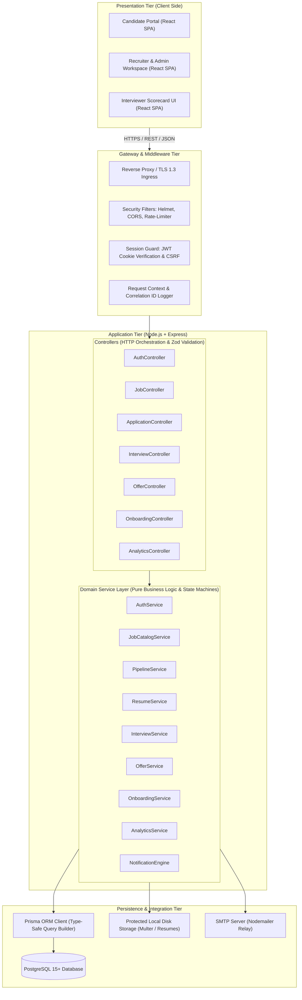
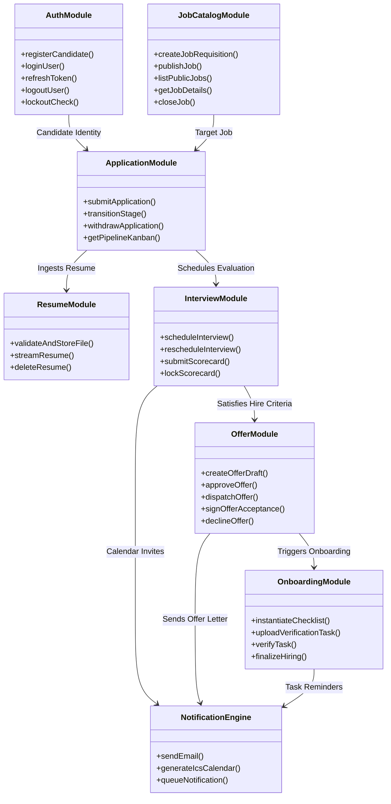

# System Architecture & Module Boundaries (SYSTEM_ARCHITECTURE)

## Smart Recruitment & Applicant Tracking System (ATS)

**Document Version:** 1.0.0  
**Status:** Approved for Implementation (Phase 1 Final)  
**Author:** Senior Full-Stack Software Architect  
**Architecture Paradigm:** Layered Modular Monolith with Domain-Driven Contexts  

---

## 1. High-Level Architecture Overview

The Smart Recruitment & Applicant Tracking System is designed as a **Layered Modular Monolith**. This paradigm combines the simplicity and atomic consistency of a unified codebase with the clean boundaries and maintainability of domain-driven services, perfectly matching production enterprise ATS requirements.



---

## 2. Layered Architecture Specifications

### 2.1 Presentation Tier (React.js + Tailwind CSS)
* **Single-Page Application (SPA):** Delivered over high-speed static delivery.
* **Component Architecture:** Atomic design hierarchy (Primitives -> Form Elements -> Composite Widgets -> Layouts -> Routed Views).
* **Enterprise Design System:** Governed by `docs/DESIGN_SYSTEM.md` and `docs/UI_UX_SPECIFICATION.md` (Deep Indigo, Slate neutrals, Inter typography, native Light and Dark theme modes, WCAG 2.1 AA accessibility).
* **Styling Engine:** Tailwind CSS providing utility-first responsive styling without CSS bundle bloat.
* **Routing & Guards:** React Router v6 enforcing role-based route protection across the 3 primary user tracks (`AdminRoute`, `RecruiterRoute`, `CandidateRoute`).
* **State Management:** React Context API for cross-cutting session state (`AuthContext`, `ToastContext`), combined with Axios HTTP instances featuring response interceptors for automatic refresh token handling.

### 2.2 Ingress & Middleware Tier
* **Helmet Middleware:** Enforces strict HTTP security headers:
  * `Content-Security-Policy`: Disallows unsafe inline scripts.
  * `Strict-Transport-Security`: Enforces TLS across all subdomains.
  * `X-Frame-Options: DENY`: Prevents clickjacking attacks.
* **Rate Limiter:** `express-rate-limit` prevents brute-force abuse:
  * Authentication endpoints: 10 requests / 15 minutes per IP.
  * Standard API endpoints: 100 requests / 15 minutes per IP.
  * File uploads: 20 uploads / 15 minutes per IP.
* **Authentication Middleware:** Intercepts `HttpOnly` access cookies, decodes and verifies JWT signatures, and attaches the authenticated user entity to `req.user`.
* **RBAC Guard Middleware:** Compares required resource-action permissions against `req.user.roles`.

### 2.3 Application & Controller Tier
* **Strict Parameter Binding:** Requests pass through schema validators (Zod) before reaching controller handlers.
* **Standardized HTTP Responses:** Controllers transform domain service results into consistent JSON payloads:
  * `200 OK`: Successful resource query or mutation.
  * `201 Created`: Resource successfully created.
  * `400 Bad Request`: Validation failure.
  * `401 Unauthorized`: Missing or invalid session token.
  * `403 Forbidden`: Insufficient role permissions.
  * `404 Not Found`: Target entity not found.
  * `500 Internal Server Error`: Unhandled operational defect.

### 2.4 Domain Service Tier
* Contains 100% of the business logic, state machine constraints, and multi-entity orchestrations.
* **Pure Logic Isolation:** Domain services do not access HTTP request or response objects directly; they receive typed parameters and return domain objects or throw typed `AppError` exceptions.
* **Transaction Coordination:** Multi-table mutations are wrapped in `prisma.$transaction`.

### 2.5 Persistence Tier (Prisma ORM + PostgreSQL)
* **Prisma ORM Client:** Generates strongly typed database queries, preventing SQL injection vectors and automating relational foreign key navigation.
* **PostgreSQL Engine:** Leverages B-Tree indexes on search fields (`email`, `status`, `jobId`, `candidateId`), relational cascading rules, unique constraints, and JSONB columns for flexible interview scorecards.

---

## 3. Domain Module Boundaries & Contracts



### Module Boundary Details

1. **Auth & Identity Module (`src/services/auth.service.js`):**
   * *Responsibilities:* Password hashing (`bcrypt`), JWT token generation/validation, refresh token rotation, user account lockouts.
   * *Boundary Rule:* Never exposes hashed passwords or refresh tokens outside the service layer.
2. **Job Catalog Module (`src/services/job.service.js`):**
   * *Responsibilities:* Job requisition lifecycle, qualification criteria, public career search queries.
   * *Boundary Rule:* Public queries filter strictly on `status = 'PUBLISHED'` and `deadline >= NOW()`.
3. **Application & Pipeline Module (`src/services/application.service.js`):**
   * *Responsibilities:* Candidate submission handling, Kanban board queries, state machine enforcement, immutable stage history logs.
   * *Boundary Rule:* Application stage transitions must satisfy the strict stage transition matrix.
4. **Resume & Document Module (`src/services/resume.service.js`):**
   * *Responsibilities:* Multer upload pipeline, magic-byte inspection, UUID disk storage, secure file streaming.
   * *Boundary Rule:* Storage paths are never stored as absolute client URLs; file streaming endpoints enforce authorization checks before reading bytes.
5. **Interview & Scorecard Module (`src/services/interview.service.js`):**
   * *Responsibilities:* Scheduling rounds, assigning interviewers, generating `.ics` iCalendar invites, recording and locking evaluation scorecards.
   * *Boundary Rule:* Scorecards become read-only immediately upon submission.
6. **Offer Letter Module (`src/services/offer.service.js`):**
   * *Responsibilities:* Compensation structure, internal approvals, digital e-signature acceptance recording (IP, timestamp, name), offer expiration triggers.
   * *Boundary Rule:* An offer cannot be sent to a candidate without documented internal approval.
7. **Onboarding Module (`src/services/onboarding.service.js`):**
   * *Responsibilities:* Instantiating onboarding tasks upon offer acceptance, document upload verification, tracking task status, final `HIRED` transition.
   * *Boundary Rule:* Candidate cannot be marked `HIRED` until 100% of mandatory onboarding tasks are `VERIFIED`.
8. **Notification Engine (`src/services/notification.service.js`):**
   * *Responsibilities:* Nodemailer SMTP abstraction, HTML template rendering, calendar invite attachment, delivery logging.
   * *Boundary Rule:* Email failures must never roll back primary database transactions; failures are recorded in the `EmailLog` table.

---

## 4. Cross-Cutting Architectural Concerns

### 4.1 Transaction Management
Database mutations modifying multiple tables execute within atomic Prisma transactions:
```javascript
const result = await prisma.$transaction(async (tx) => {
  // 1. Update Application stage
  const updatedApp = await tx.application.update({
    where: { id: applicationId },
    data: { stage: newStage }
  });

  // 2. Insert immutable audit history
  await tx.applicationStageHistory.create({
    data: {
      applicationId,
      fromStage: currentStage,
      toStage: newStage,
      changedByUserId,
      reason
    }
  });

  return updatedApp;
});
```

### 4.2 Centralized Error Handling Pipeline
```
[Route Handler Error]
        │
        ▼
[next(error)] ──► [Global Error Middleware]
                          │
            ┌─────────────┴─────────────┐
            ▼                           ▼
   [Is Operational AppError?]     [Unknown / System Bug]
            │                           │
            ├─► Set statusCode          ├─► Log full stack trace
            ├─► Return JSON error       ├─► Set statusCode = 500
            └─► Include details/field   └─► Return generic error message
```

### 4.3 Audit Logging Architecture
All administrative and state-altering actions persist an entry in the `AuditLog` table with:
* `id`: UUID.
* `userId`: ID of actor (or NULL for unauthenticated actions).
* `action`: Enum (e.g., `USER_LOGIN`, `STAGE_TRANSITION`, `OFFER_APPROVED`, `SCORECARD_SUBMITTED`).
* `resource`: Target entity name (`Application`, `JobOffer`, etc.).
* `resourceId`: UUID of target entity.
* `payload`: JSONB capturing changed attributes.
* `ipAddress`: Client IP address.
* `userAgent`: Browser / Client string.
* `createdAt`: Immutable UTC timestamp.
