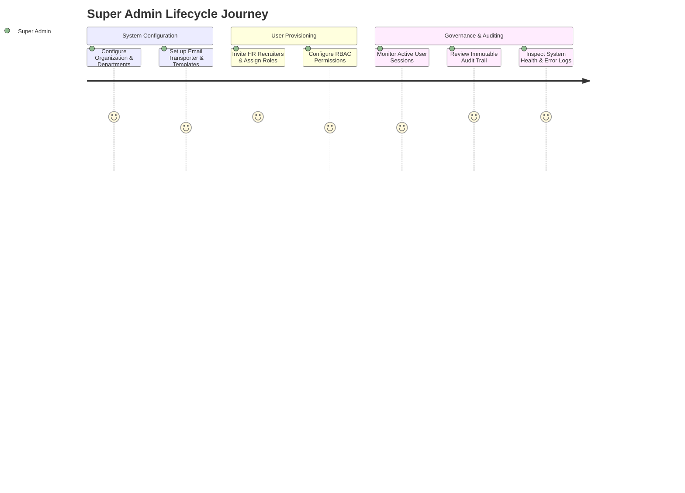
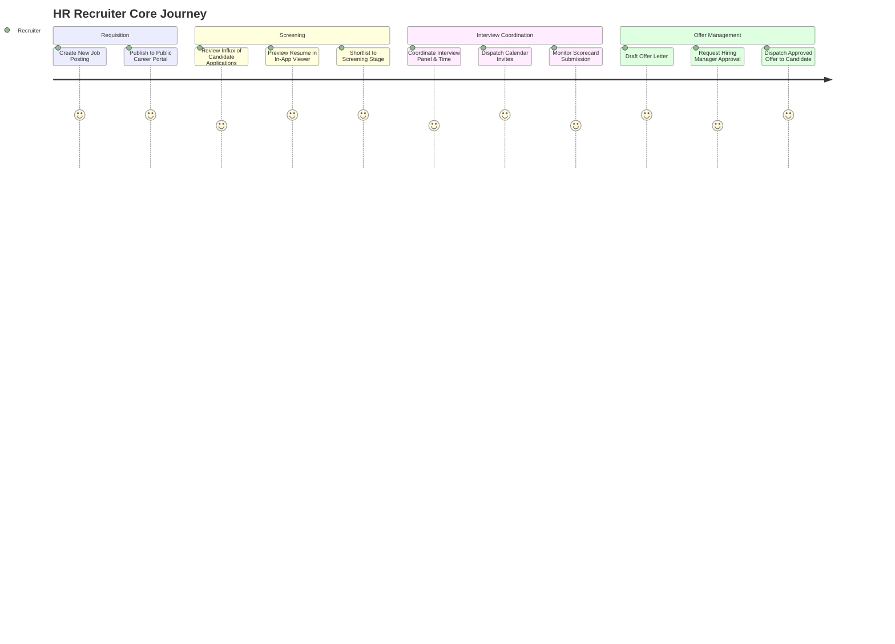
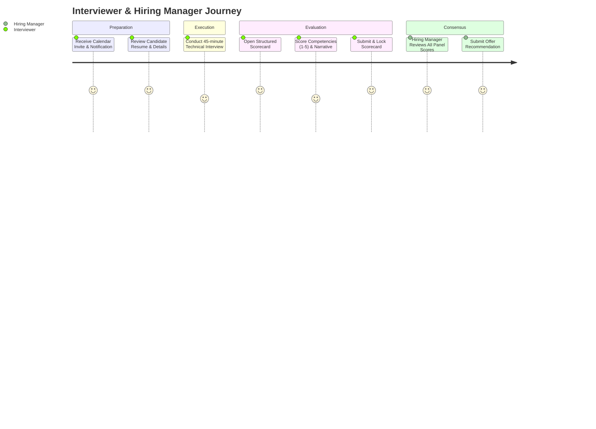
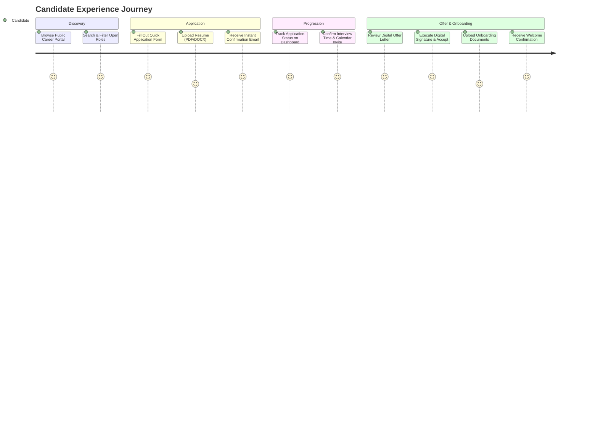

# User Journeys Specification (USER_JOURNEYS)

## Smart Recruitment & Applicant Tracking System (ATS)

**Document Version:** 1.0.0  
**Status:** Approved for Implementation (Phase 1 Final)  
**Author:** Senior Full-Stack Software Architect  

---

## 1. User Persona Profiles & Track Reconciliation

The user journeys are organized under the **Three Primary User Tracks** mandated by enterprise recruitment workflows:

### Track 1: Admin Track

#### Persona 1: Sarah Jenkins - Super Administrator
* **System Role:** `SUPER_ADMIN` (IT & Operations Lead)
* **Demographics:** Age 38, 12 years in IT & Systems Management.
* **Goals:** Maintain zero-downtime system stability, ensure strict data privacy and GDPR/DPDP compliance, manage role permissions, and audit sensitive recruitment actions.
* **Pain Points:** Complex user permission setups, difficulty tracing who modified candidate status, and potential data leaks of sensitive candidate PII.

---

### Track 2: HR & Talent Operations Track

#### Persona 2: Marcus Vance - Lead HR Recruiter
* **System Roles:** `HR_MANAGER` / `RECRUITER`
* **Demographics:** Age 31, 7 years in corporate talent acquisition.
* **Goals:** Source high-quality talent swiftly, manage high application volumes without dropping candidates, schedule interviews seamlessly, and reduce time-to-hire.
* **Pain Points:** Spreadsheets losing sync, back-and-forth emails to schedule interviews with busy engineers, and chasing interviewers for evaluation feedback.

#### Persona 3: David Chen - Engineering Hiring Manager
* **System Role:** `HIRING_MANAGER`
* **Demographics:** Age 42, VP of Engineering.
* **Goals:** Fill technical vacancies with top engineers, review candidate resumes quickly, assess objective interview scorecards, and make data-driven offer decisions.
* **Pain Points:** Overwhelmed by unqualified resumes, lack of structured feedback from panel interviewers, and delays in generating offer letters.

#### Persona 4: Elena Rostova - Technical Interviewer
* **System Role:** `INTERVIEWER` (Senior Full-Stack Engineer)
* **Demographics:** Age 29, 6 years in software engineering.
* **Goals:** Review candidate resume and code portfolio before the interview, evaluate candidate against standardized technical criteria, and submit feedback in under 10 minutes.
* **Pain Points:** Having to search across Slack and email for candidate resumes, unclear evaluation rubrics, and tedious feedback submission forms.

---

### Track 3: Candidate Track

#### Persona 5: Alex Rivera - Software Engineer Candidate
* **System Role:** `CANDIDATE` (Applicant)
* **Demographics:** Age 26, Full-Stack Developer actively seeking a new role.
* **Goals:** Find relevant job openings effortlessly, apply with minimal friction, track application status transparently, easily join scheduled interviews, and sign offer letters digitally.
* **Pain Points:** The "black hole" of job applications (no updates for weeks), confusing scheduling processes, and clunky onboarding paperwork.

---

## 2. End-to-End User Journey Maps

### 2.1 Journey 1: Super Admin - Enterprise Setup & Governance

| Phase | User Action | System Touchpoint | Thought & Sentiment | Pain Point | Platform Solution |
| :--- | :--- | :--- | :--- | :--- | :--- |
| **Setup** | Logs in with 2FA / Secure credentials | `/admin/login` | *"I need to ensure the system is locked down and configured properly."* (Focused) | Fear of misconfiguration. | Secure default settings, automated environment verification. |
| **Provisioning** | Invites Recruiters and assigns `HR_MANAGER` and `INTERVIEWER` roles | `/admin/users/new` | *"I want to quickly onboard the talent team without giving them superadmin access."* (Confident) | Accidental elevation of privileges. | Strict RBAC matrix with principle of least privilege enforced at API level. |
| **Audit Review** | Filters audit log by candidate ID or user action | `/admin/audit-logs` | *"Did someone view salary details or delete a record?"* (Vigilant) | Untraceable deletions or data leaks. | Immutable database audit log tracking actor ID, IP, action, and payload diff. |

---

### 2.2 Journey 2: HR Recruiter - Candidate Sourcing to Offer Dispatch

| Step | Action | User Goal | Emotional State | System Feature |
| :--- | :--- | :--- | :--- | :--- |
| **1. Create Job** | Inputs job details, requirements, compensation, and publishes opening. | Publish vacancy to company career page. | Optimistic | Form with rich-text editor, validation, and auto-save draft. |
| **2. Triage Applications** | Opens Kanban board, reviews incoming applicants under `APPLIED`. | Filter out unqualified candidates rapidly. | Determined | Interactive Kanban board with instant resume preview drawer. |
| **3. Coordinate Interview** | Selects candidate, chooses round type, picks interviewer, adds meeting URL. | Schedule round without endless email chains. | Relieved | One-click scheduling engine dispatching calendar `.ics` invites. |
| **4. Review Feedback** | Checks candidate profile to view aggregate scorecard submitted by interviewers. | Reach hiring consensus based on objective data. | Informed | Consolidated scorecard summary highlighting average ratings. |
| **5. Issue Offer** | Generates digital offer letter with compensation breakdown and joins dates. | Close the candidate before competing offers. | Excited | Dynamic offer letter templating with approval workflow. |

---

### 2.3 Journey 3: Hiring Manager & Interviewer - Objective Evaluation

| Step | Interviewer Experience | System Touchpoint | Friction Prevented |
| :--- | :--- | :--- | :--- |
| **1. Notification** | Receives calendar notification with direct link to candidate profile. | Email / Calendar (`.ics`) | No digging through email to find candidate resume. |
| **2. Review** | One-click access to candidate resume, portfolio, and prior interview notes. | `/interviews/:id/brief` | Context is ready 5 minutes before the interview begins. |
| **3. Interview** | Focuses entirely on evaluating technical and cultural skills. | Video link provided in invite | Consistent interview parameters across all candidates. |
| **4. Scorecard Submission**| Rates 4 standardized categories (1-5) and enters qualitative recommendation. | `/interviews/:id/scorecard`| Eliminates subjective "gut feeling" reviews. |
| **5. Locking** | Submits scorecard; record is locked immediately to prevent tampering. | PostgreSQL transaction | Guarantees compliance and audit readiness. |

---

### 2.4 Journey 4: Candidate - Discovery, Application, and Onboarding

| Touchpoint | Candidate Interaction | Emotional Curve | System Design Feature |
| :--- | :--- | :--- | :--- |
| **Career Board** | Discovers job opening, filters by department and remote options. | Curios / Interested (😀) | Fast, responsive public board styled with Tailwind CSS. |
| **Application** | Uploads resume and fills in personal details in under 2 minutes. | Hopeful (😊) | Friction-free application form; instant Multer validation. |
| **Acknowledgment** | Receives email confirmation with login credentials for candidate portal. | Reassured (😃) | Automated Nodemailer transactional receipt. |
| **Tracking** | Logs in to Candidate Dashboard to see current stage (`SCREENING`). | In Control (😎) | Transparent progress tracker eliminating candidate ghosting. |
| **Interview** | Accepts `.ics` calendar invite; joins scheduled meeting. | Prepared (🧐) | Synchronized calendar notifications and meeting links. |
| **Offer** | Receives offer alert, reviews salary and benefits, types name to sign. | Delighted (🎉) | Legally compliant digital acceptance with timestamp & IP recording. |
| **Onboarding** | Uploads ID and bank proofs onto simple checklist dashboard. | Accomplished (🚀) | Clear step-by-step onboarding task list with status feedback. |

---

## 3. Empathy Maps

### Candidate Empathy Map
* **Says:** *"I want to know where my application stands without having to send follow-up emails."*
* **Thinks:** *"Will my resume actually be read by a human? Is this company organized?"*
* **Does:** Searches for jobs, uploads resume, checks email repeatedly, prepares for interview.
* **Feels:** Anxious during waiting periods, excited when receiving interview and offer notifications.
* **Architectural Response:** Real-time Candidate Dashboard, immediate transactional emails at every milestone, transparent stage progression.

### Recruiter Empathy Map
* **Says:** *"I need to fill 5 engineering roles this month, and I have 300 applicants to review."*
* **Thinks:** *"I hope the interviewers submit their feedback today so we don't lose this great candidate."*
* **Does:** Moves candidate cards across Kanban board, schedules panel interviews, follows up on scorecards.
* **Feels:** Overwhelmed by volume, pressured by hiring timelines.
* **Architectural Response:** Visual drag-and-drop Kanban pipeline, automated interviewer reminders, one-click offer generation.
